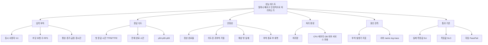

# 7. 성능 테스트의 기본 개념

성능 테스트는 단순히 "몇 명까지 접속되는가"를 세는 일이 아니다. 부하가 커질 때 시스템이 얼마나
빠르게 처리하고, 어떤 방식으로 한계를 드러내며, 부하가 사라진 뒤 정상 상태로 회복하는지를 숫자로
설명하는 일이다.

## 개념 지도



## 부하를 표현하는 세 가지 숫자

| 개념 | 뜻 | 주의할 점 |
|---|---|---|
| 동시 사용자(VU) | 동시에 행동하는 가상 사용자 수 | 응답을 기다리는 동안 새 요청을 만들지 않는 사용자 모델일 수 있다 |
| 동시 요청 | 아직 완료되지 않고 처리 중인 요청 수 | 서버와 외부 서비스가 실제로 점유된 양에 가깝다 |
| RPS/RPM | 초·분마다 새로 시작되는 요청 수 | 느려져도 같은 속도로 유입되는 open model과 잘 맞는다 |

세 값은 서로 같지 않다. 평균적으로 다음 관계를 이용해 필요한 동시 처리량을 추정할 수 있다.

```text
동시 처리 요청 수 ≈ 초당 유입 요청 수 × 평균 처리 시간(초)
```

평균 처리 시간이 30초이고 분당 6개, 즉 초당 0.1개가 들어오면 평균 약 3개가 동시에 실행된다. 이는
추정식일 뿐이며 실제 테스트에서는 측정한 동시 요청 수를 함께 기록한다.

## 응답 속도는 분포로 읽는다

- **TTFB(Time To First Byte)**: 요청 후 첫 응답 바이트까지의 시간이다.
- **TTFE(Time To First Event)**: SSE처럼 이벤트를 받는 연결에서 첫 의미 있는 이벤트까지의 시간이다.
- **전체 완료 시간**: 마지막 결과를 모두 받을 때까지의 시간이다.
- **p50**: 요청 절반이 이 시간 안에 끝났다는 뜻이다.
- **p95**: 요청 95%가 이 시간 안에 끝났다는 뜻으로 일반적인 성능 기준선에 적합하다.
- **p99**: 가장 느린 꼬리 구간을 드러내지만 표본이 적으면 흔들린다.

평균만으로는 느린 소수 요청을 숨길 수 있다. `p50`, `p95`, `p99`, 최대값과 표본 수를 함께 본다.
여러 서버 인스턴스의 latency를 합칠 때는 인스턴스별 percentile을 평균내지 않고 histogram 원자료를
합산한다. Prometheus 공식 문서도 집계 가능한 latency 분포에는 histogram을 권한다.

## 성공, 거절, 실패를 나눈다

정상적인 과부하 보호는 장애와 다르다.

| 결과 | 예 | 해석 |
|---|---|---|
| 정상 완료 | 필요한 결과와 종료 이벤트를 모두 받음 | 성공 |
| 의도된 거절 | 용량 제한을 넘겨 `busy`로 즉시 거절 | 시스템 보호가 동작함 |
| 예상 밖 실패 | timeout, 500, 연결 단절, 잘못된 응답 | 신뢰성 결함 또는 외부 의존성 장애 |

HTTP `200`만으로 성공을 판정하면 안 된다. 스트림의 필수 이벤트, 응답 schema, 최종 상태까지 확인해야
한다. 반대로 의도된 `busy`를 모두 서버 장애로 합치면 시스템이 안전하게 자신을 보호한 사실을 잃는다.

## 처리량과 포화

처리량은 단위 시간에 실제 완료한 작업 수다. 유입량을 계속 늘려도 완료 처리량이 더 늘지 않고 latency나
대기만 커지는 지점이 포화점이다. 원인은 CPU만이 아니다.

- CPU, 메모리, event loop 지연
- DB connection pool과 query latency
- 네트워크 연결 수
- 애플리케이션 동시성 제한
- 외부 API의 rate limit, queue, timeout과 공유 용량

외부 AI API를 호출하는 서비스에서는 `사용자 요청 수`와 `외부 API 호출 수`도 다르다. 한 사용자 요청이
라우팅, 임베딩, 생성으로 여러 외부 호출을 만들 수 있으므로 두 수를 별도로 기록한다.

## 부하 모델과 테스트 종류

- **Closed model**: 한 사용자가 이전 행동을 마친 뒤 다음 행동을 한다. 실제 사용자 여정과 동시 사용자
  수를 재현하기 좋지만, 서버가 느려지면 새 요청도 줄어드는 coordinated omission이 생길 수 있다.
- **Open model**: 처리시간과 무관하게 정해진 RPS로 새 요청을 시작한다. 정확한 유입 한계와 대기 증가를
  찾기 좋다.

| 종류 | 목적 |
|---|---|
| Smoke | 테스트 스크립트와 성공 판정 자체가 맞는지 확인 |
| Baseline | 작은 부하에서 비교 기준 확보 |
| Load | 예상 평상 부하를 안정적으로 처리하는지 확인 |
| Capacity/Stress | 최대 안정 처리량과 한계 초과 동작 확인 |
| Spike | 갑작스러운 유입 증가 확인 |
| Soak | 장시간 누수와 점진적 성능 저하 확인 |
| Recovery | 부하 제거 후 정상 상태로 돌아오는지 확인 |

## SLI, SLO, Threshold

- **SLI**는 `p95=28초`, `예상 밖 실패율=0.2%`처럼 실제 관측한 값이다.
- **SLO**는 `p95<35초`, `예상 밖 실패율<1%`처럼 만족하려는 목표다.
- **Threshold**는 SLO를 테스트 도구가 자동으로 Pass/Fail하도록 만든 조건이다.

첫 실행부터 임의의 SLO를 사실처럼 정하지 않는다. 먼저 baseline을 구하고 사용자 경험 요구, 플랫폼의
hard timeout, 비용과 외부 의존성 계약을 함께 보아 목표를 정한다.

## 결과를 재현 가능하게 만드는 기록

성능 숫자는 실행 조건과 함께 있어야 비교할 수 있다.

- run ID, 실행 시각과 시간대, Git SHA
- local/staging/production, 서버·부하 발생기 지역
- 설정값, 인스턴스 수, 동시성 제한, timeout
- 시나리오, VU/RPS, ramp, 지속시간, think time
- 요청·외부 API 호출 수, 성공·거절·실패 수와 오류 코드
- latency p50/p95/p99/max와 표본 수
- CPU·메모리·DB pool·재시작·회복시간
- 외부 provider 종류, 실제 endpoint/tier, retry와 rate-limit 응답

질문 원문, 법률 근거 원문, 인증정보와 사용자 식별자는 성능 로그에 넣지 않는다. 고정된 `scenario_id`와
안전한 오류 분류만 기록한다.

## 참고 자료

- [Grafana k6: open model과 closed model](https://grafana.com/docs/k6/latest/using-k6/scenarios/concepts/open-vs-closed/)
- [Grafana k6: 성능 테스트 자동화와 테스트 종류](https://grafana.com/docs/k6/latest/testing-guides/automated-performance-testing/)
- [Prometheus: histograms and summaries](https://prometheus.io/docs/practices/histograms/)
- [OpenTelemetry signals](https://opentelemetry.io/docs/concepts/signals/)

## 핵심 확인

1. 동시 사용자 수와 RPS가 같은 숫자가 아닌 이유는 무엇인가?
2. 의도된 과부하 거절과 예상 밖 실패를 왜 분리해야 하는가?
3. 외부 AI API가 있는 서비스에서 사용자 요청 수만 기록하면 무엇을 놓치는가?
